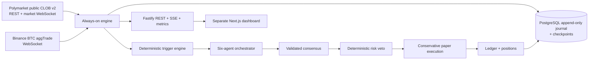
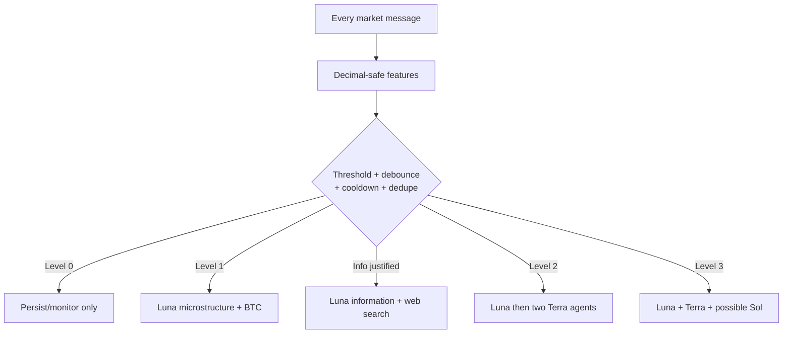
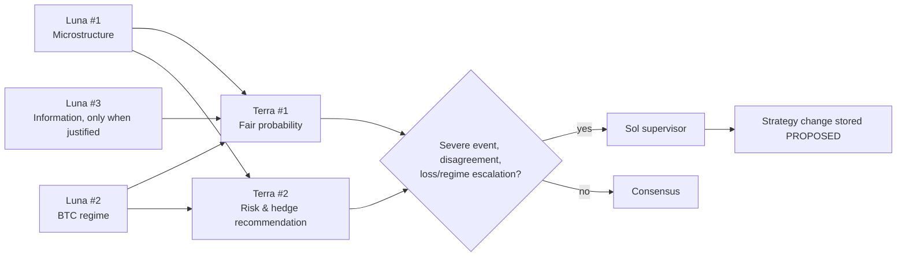
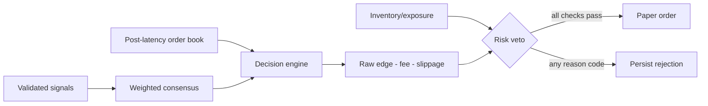
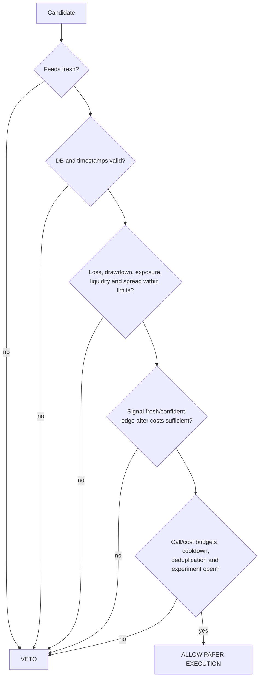

# Polymarket Research & Paper-Trading Engine

Production-shaped, event-driven research system for a 48-hour experiment using public live Polymarket and BTC data. It creates **paper orders only**. There is no wallet integration, signer, private CLOB client, or live-order path; `TRADING_MODE` accepts only `paper`, and the live adapter always throws `LIVE_TRADING_DISABLED`.

## Architecture



The pnpm workspace contains `apps/engine`, `apps/dashboard`, and focused `packages/core`, `packages/db`, and `packages/market-data`. PostgreSQL journal events are the canonical audit trail. Typed tables and migrations cover markets, snapshots, triggers, invocations/outputs, consensus, risk, orders/fills, positions/hedges, PnL, costs, health, strategy versions/proposals, experiments, journal events, and checkpoints.

Every important event carries a trace ID. `/api/traces/:traceId` reconstructs the source market evidence, participating agents, consensus, risk result, order/fill, and resulting position from the append-only journal.

## Trigger and agent flow





Exactly six logical agent definitions exist: three `gpt-5.6-luna`, two `gpt-5.6-terra`, and one escalation-only `gpt-5.6-sol`. They use the OpenAI Agents SDK `Agent`, `Runner`, Zod `outputType`, cancellation, tracing metadata, usage capture, and replaceable pricing. Agents receive no order tool. Missing `OPENAI_API_KEY` produces model-unavailable events while deterministic monitoring continues.

## Deterministic trade and risk





Risk has absolute veto authority and emits machine-readable codes. Limits include order/market/total/directional/unhedged exposure, unhedged duration, loss/drawdown, liquidity, edge, spread, signal confidence/expiry, feed staleness, agent rate/cost budgets, cooldown, duplicates, unknown fees, execution failures, experiment closure, and shutdown.

The Temporal Pair/Hedge strategy is behind a pluggable interface. A pair becomes locked only after both real-book-derived simulated fills exist. Until then, first-leg quantity and directional exposure remain explicit.

## Paper fill model

- **Taker:** wait configured latency, use the latest resulting snapshot, walk visible contra depth, require full quantity, calculate VWAP, actual market fee schedule, and requested-vs-fill slippage. Stale/missing/insufficient depth does not fill.
- **Maker:** create a resting order with visible quantity at the price as `queueAhead`. Never fill on submission. On a later, increasing-sequence book event, consume queue ahead first; only 50% of additional observed disappearance is eligible for fill. Confidence is `0.5`. Cancellations and hidden liquidity cannot be distinguished, so this intentionally understates fills.
- Fee formula follows the market fee schedule: `shares × rate × [p × (1-p)]^exponent`, rounded to five decimals; taker-only schedules charge makers zero. An unknown schedule vetoes.

These are research approximations, not exchange execution guarantees.

## Local setup

Requirements: Node 22+, pnpm 11+, PostgreSQL 17 (or compatible).

```bash
cp .env.example .env
docker compose up -d postgres
pnpm install
pnpm typecheck
pnpm test
pnpm build
```

Run the services in separate terminals:

```bash
pnpm dev:engine
pnpm dev:dashboard
```

Dashboard: `http://localhost:3000`; engine liveness/readiness/metrics: `http://localhost:8080/health`, `/ready`, `/metrics`. The dashboard connects through its server-side `ENGINE_INTERNAL_URL` proxy, so the private engine address and engine secrets are not shipped to the browser.

### Environment variables

| Variable | Purpose / default |
|---|---|
| `TRADING_MODE` | Zod literal `paper`; anything else fails startup |
| `DATABASE_URL` | Required with `JOURNAL_MODE=postgres` |
| `JOURNAL_MODE` | `postgres`; `memory` is development/test-only and forbidden in production |
| `PAPER_START_BALANCE` | Configurable paper cash, default `1000` |
| `PAPER_EXECUTION_STYLE` | `TAKER` or `MAKER` |
| `PAPER_EXECUTION_LATENCY_MS` | Simulated decision-to-book latency, default `150` |
| `EXPERIMENT_DURATION_HOURS` | Default `48` |
| `EXPERIMENT_CLOSE_POLICY` | `observe_until_settlement` or `mark_to_market` |
| `POLYMARKET_MARKET_SLUGS` | Optional comma-separated explicit live markets |
| `POLYMARKET_TOKEN_IDS` | Optional manual public token IDs; missing fee metadata will veto fills |
| `BTC_WS_URL`, `BTC_SYMBOL` | Public BTC feed; Binance aggTrade default |
| `AI_ENABLED` | Enables event-triggered calls; monitoring survives failures/budget exhaustion |
| `OPENAI_API_KEY` | Optional engine-only secret; never required/provisioned by this repository |
| `AI_HOURLY_BUDGET_USD`, `AI_DAILY_BUDGET_USD` | Hard nonessential-call budgets |
| `ESTIMATED_INFRA_COST_PER_HOUR_USD` | Accrued into economic PnL |
| `DASHBOARD_ORIGIN` | Allowed browser origin for engine API |
| `ENGINE_INTERNAL_URL` | Dashboard server-to-engine URL; not `NEXT_PUBLIC_*` |
| `ENGINE_REGION` | Runtime metadata; `fra` default |
| `GIT_SHA` | Recorded in experiment manifest |
| `REPORT_DIRECTORY` | Automatic summary output, default `reports` |

Do not put wallet keys, signing keys, or Polymarket private credentials in this milestone.

## Commands and verification

```bash
pnpm typecheck             # strict TypeScript across all workspaces
pnpm test                  # unit, integration-boundary, malicious-output acceptance
pnpm build                 # engine bundle + standalone Next dashboard
pnpm smoke                 # deterministic fixture: consensus -> fill -> ledger
pnpm smoke:live            # public Polymarket + BTC connectivity; no orders/agents
pnpm report                # rebuild reports/48h-summary.{json,md} from DATABASE_URL journal
```

Tests cover pair/PnL math, fee curve, slippage/VWAP, exposure/accounting, consensus, stale/expired/budget/risk vetoes, maker/taker execution, insufficient depth, trigger dedupe, provider failure, invalid output, timeout, journal outage/recovery, reconnect backoff, feed parsing, exact-six topology, and the hard live-order gate.

## 48-hour procedure

1. Set a durable `DATABASE_URL`, `TRADING_MODE=paper`, market selection (or allow BTC discovery), budget values, `GIT_SHA`, and optionally an existing `OPENAI_API_KEY`.
2. Run all verification commands and `pnpm smoke:live`.
3. Start once with `EXPERIMENT_DURATION_HOURS=48 pnpm experiment:start` (PowerShell: `$env:EXPERIMENT_DURATION_HOURS='48'; pnpm experiment:start`).
4. Monitor `/ready`, `/metrics`, dashboard SSE state, risk vetoes, AI budget, directional positions, and journal growth.
5. At the deadline the engine changes the manifest to `ENTRY_CLOSED`, stops opening new positions, checkpoints, retains raw data, and writes both summary files. Existing positions remain observed per policy.
6. Rebuild the report at any time with `DATABASE_URL=... EXPERIMENT_ID=... pnpm report`.

The report includes opportunities, accepts/rejects, orders/fills and rates, maker/taker split, completed/incomplete pairs, win/loss events, PnL/cost layers, drawdown/exposure, hedge duration/failures, pair/edge statistics, per-agent counts/cost/performance events, regime/hour attribution, counterfactual event counts, and errors. Metrics without observed attribution events remain empty/zero rather than fabricated.

## Fly.io: two independent apps

The engine is a singleton, always-on Machine; the dashboard is independently restartable/autostoppable. The dashboard should use the engine's private Flycast address, e.g. `http://polymarket-engine.flycast:8080`. For this initial milestone use one engine Machine (`--ha=false`) to prevent duplicate paper decisions. Multi-Machine deployment requires leader election/idempotent work claiming.

Validate before deploying:

```bash
fly config validate --strict -a polymarket-engine -c fly.engine.toml
fly config validate --strict -a polymarket-dashboard -c fly.dashboard.toml
docker build -f Dockerfile.engine -t polymarket-engine:local .
docker build -f Dockerfile.dashboard -t polymarket-dashboard:local .
```

Exact creation/deployment sequence (run only after validation):

```bash
fly apps create polymarket-engine --org <org>
fly apps create polymarket-dashboard --org <org>
fly secrets set -a polymarket-engine DATABASE_URL='<postgres-url>' OPENAI_API_KEY='<optional-existing-key>'
fly secrets set -a polymarket-dashboard ENGINE_INTERNAL_URL='http://polymarket-engine.flycast:8080'
fly deploy -a polymarket-engine -c fly.engine.toml --flycast --ha=false
fly deploy -a polymarket-dashboard -c fly.dashboard.toml --ha=false
```

`fly.engine.toml` has `auto_stop_machines="off"`, one minimum Machine, SIGTERM/60s, `/health`, `/ready`, Prometheus metrics, and restart-always. `fly.dashboard.toml` has its own image/fate, health check, autostop, and no engine credentials.

## Recovery and operational behavior

On SIGTERM the engine marks itself draining/not-ready, rejects new decisions, aborts pending agent runs, stops feed loops, accrues infrastructure cost, saves an experiment/ledger/position/resting-order checkpoint, closes SSE/journal, and exits before Fly's kill timeout. On boot it migrates/checks PostgreSQL with bounded retry, restores the latest checkpoint, reconnects both feeds, and becomes ready only after DB plus first messages from both feeds.

Health semantics: `/health` means the process is alive; `/ready` requires non-draining engine, DB, connected Polymarket/BTC streams, and initial messages. Fly health-check failures alone do not restart a process; the always restart policy covers process exits.

## Known limitations

- No live trading, wallet, authentication/signing, settlement transaction, or private CLOB endpoint exists by design.
- A real 48-hour outcome cannot be produced during repository construction. Reports are generated only from recorded events; no performance claim is included.
- Live agent calls need an operator-supplied existing `OPENAI_API_KEY`; without it, their real token/cost and contribution statistics cannot be observed.
- Full PostgreSQL/docker recovery and strict Fly validation require locally available PostgreSQL, Docker, and Fly CLI. In-memory recovery tests validate the repository contract but are not a substitute for a fault-injected production database test.
- Public feed payloads/rate limits/fees can evolve. The adapter uses current unified `@polymarket/client` market APIs and preserves raw payloads, but should be revalidated before each experiment.
- Maker queue inference cannot identify cancellations, hidden liquidity, or queue priority; the 50% post-queue rule is deliberately conservative.
- Initial Fly topology is a singleton engine. Horizontal engine scaling is unsafe until leader election and event claiming are implemented.
- Attribution-by-agent/regime/hour and rejected-winner labels require downstream outcome/settlement observations; absent labels are reported as absent, never inferred.

Current implementation references: [OpenAI Agents SDK](https://openai.github.io/openai-agents-js/), [OpenAI model documentation](https://platform.openai.com/docs/models), [Polymarket developer documentation](https://docs.polymarket.com/), and [Fly Machines documentation](https://fly.io/docs/machines/).
