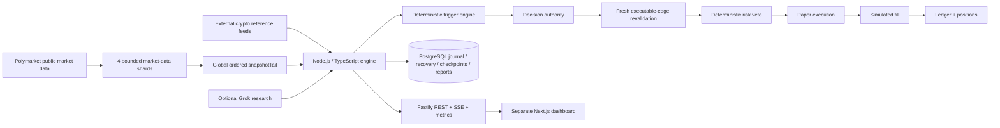

# Polymarket Research & Paper-Trading Engine

Production-shaped, event-driven **paper-trading** and research engine for public Polymarket crypto prediction markets.

> [!IMPORTANT]
> **Current production engine deployment is OVH VPS + Docker + Caddy. It is not Fly.io.**
>
> `fly.engine.toml` and `fly.dashboard.toml` are historical repository artifacts. Do **not** use them as the source of truth for the current production deployment and do not run `fly deploy` unless the deployment architecture is explicitly changed again.
>
> For production work, verify the live runtime first. Main can be ahead of production.

## Safety boundary

This repository is **PAPER ONLY**.

- `TRADING_MODE=paper`
- no wallet integration
- no private key / signer path
- no live CLOB order placement
- no live-money execution
- paper positions are created only after simulated fills
- risk retains deterministic veto authority
- malformed or ambiguous state fails closed

Do not add or infer a live execution path from deployment or API code.

## Current production platform

The engine currently runs as a Docker container on an OVH VPS in Frankfurt.

Current operational shape:

```text
OVH VPS
  ↓
Docker: polymarket-engine
  ↓
127.0.0.1:8080 -> container 8080
  ↓
Caddy reverse proxy
  ↓
Fastify engine API / SSE / metrics
```

Production paths used by the operator:

```text
repository checkout: /opt/polymarket-engine
environment file:    /etc/polymarket-engine/engine.env
container name:      polymarket-engine
engine listen:       127.0.0.1:8080
```

The engine container currently uses bridge networking, no mounted volumes, no Docker CPU/memory quota, and restart policy `no`. Deployment is intentionally controlled so the previous container/image can be retained as a rollback point.

**Do not copy `.env.example` over production.** Production has explicit overrides that may differ from repository defaults.

## Current architecture



### Important concurrency fact

Polymarket input is sharded, but downstream snapshot processing currently reconverges into one globally ordered serialized chain before `Engine.onMarketSnapshot()`.

That preserves deterministic ordering, but it also means the main Node.js thread remains the central CPU boundary. Do not remove global ordering casually.

## Decision and state ordering

The required economic order is:

```text
trusted market/reference
→ trigger
→ decision authority
→ fresh executable edge revalidation
→ deterministic risk veto
→ paper execution
→ fill
→ ledger / position
```

A position must never appear before a fill.

Critical invariants:

- malformed incremental book data cannot partially mutate trusted state
- stale/out-of-order market timestamps are safe-dropped
- malformed incremental data gaps/resyncs the affected token
- book publication is atomic
- published snapshots remain immutable
- bid/ask ordering remains deterministic
- global snapshot ordering remains deterministic
- critical persistence failures fail closed
- recovery/checkpoint/report integrity is not weakened for performance
- provider authorization evidence is durable before paid provider dispatch
- unknown provider outcome remains fail-closed
- experiment lifecycle and provider in-flight work are fenced

## Market-data pipeline

The market-data layer is bounded and recovery-aware:

- default 4 Polymarket market-data shards
- binary outcomes for one market stay on the same shard
- bounded ingress queues
- raw message size limits
- generation fencing
- gap detection and resync
- malformed `price_change` causes token resync rather than trusted partial mutation
- reference feeds use independent bounded/generation-fenced handling and stale watchdogs

### PR50 incremental book optimization

The current main includes the PR50 optimization of the `price_change` hot path.

Before PR50, an incremental level change could clone both book sides, invalidate the validation proof for the whole book, and walk unchanged levels again. Production profiling showed `assertBookLevel`, `cloneBookState`, `commitPriceChange`, `assertSnapshotPublishable`, and `toSnapshot` dominating the hot path during bursts.

PR50 preserves semantics while reducing that cost:

- copy-on-write only for the mutated book side
- previously validated unchanged levels retain their validation proof
- full-book messages still receive full validation
- redundant full-book validation is avoided after publication safety is already proven
- a token is staged once per source payload
- accepted entries still emit immutable snapshots in source order

Corrected deterministic local benchmark, 45 levels/side, 8,000 events and 32,000 snapshots:

| Metric | Before | After |
|---|---:|---:|
| wall time | 463.2 ms | 173.7 ms |
| CPU time | 476.1 ms | 184.1 ms |
| events/sec | 17,270 | 46,050 |
| snapshots/sec | 69,080 | 184,200 |

This is a local benchmark, not a production guarantee. Production CPU/event-loop validation is required after deploy.

Replay locally with:

```bash
pnpm bench:price-change
```

## CPU / event-loop investigation status

Recent production profiling established a **single-hot-main-thread bottleneck** under high market bursts:

- host exposes 2 vCPUs
- main Node thread can reach ~100% of one logical CPU
- second vCPU is mostly unused by the synchronous JS hot path
- event-loop utilization can approach `1.0`
- p99 event-loop lag reached seconds during heavy bursts
- V8 burst profile showed ~1.7% idle time
- journal `CONNECT_TIMEOUT` and WebSocket instability correlate with saturation periods

The primary performance hypothesis is therefore **main event-loop CPU saturation**, not a generic host-network outage.

Do not immediately increase queues/concurrency or move to worker threads. First measure the current PR50 production runtime. Worker-thread / multi-core restructuring is only justified if the optimized single-thread path still saturates under real load.

## Astra

Astra is opt-in, paper-only decision infrastructure. Grok remains advisory/non-authoritative.

Current safety properties include:

- paid FAST dispatch hard cap: max 12/hour
- global minimum dispatch interval
- per-market cooldown
- explicit FAST / DEEP / BATCH timeouts
- OpenAI retries disabled at the provider client boundary
- durable authorization before SDK dispatch
- provider-start evidence only after an SDK operation exists
- known usage retained for accounting
- ambiguous `DISPATCHED_UNKNOWN` remains fail-closed
- lifecycle/report/source-seal operations are fenced from in-flight provider work

Production values can differ from repository defaults. For example, current production has used:

```text
ASTRA_FAST_TIMEOUT_MS=30000
ASTRA_DEEP_TIMEOUT_MS=30000
ASTRA_FAST_MIN_DISPATCH_INTERVAL_MS=90000
```

Always inspect the live container/environment before changing these values.

## PostgreSQL journal and recovery

PostgreSQL is the canonical durable state for experiment, execution, recovery, reporting, and retention facts.

The engine includes:

- append-only journal events
- durable transitions
- recovery cursors / replay keys
- checkpoints
- analytics/report rollups
- experiment reports
- integrity validation and fail-closed recovery
- retention/compaction safety fences

Production currently uses Supabase PostgreSQL. Intermittent session-pooler `CONNECT_TIMEOUT` has been observed during severe engine event-loop saturation. Do not assume the database or network is the root cause without correlated measurements.

## Health and operator API

Core endpoints:

```text
GET  /health
GET  /ready
GET  /metrics
GET  /api/dashboard
GET  /api/history/equity
GET  /api/history/decisions
GET  /api/traces/:traceId
GET  /events
POST /api/operator/experiment/start
POST /api/operator/experiment/close-entries
POST /api/operator/experiment/prepare-next
```

Production read APIs are protected with `ENGINE_READ_TOKEN`; operator mutations use `ENGINE_OPERATOR_TOKEN`.

`/health` is lightweight liveness. `/ready` reports runtime readiness state such as DB, market monitoring, discovery, overload, journal degradation, and paper-entry eligibility.

Do not infer experiment state from `/ready` alone. Use the authenticated dashboard state when an exact `experimentStatus`, position count, or queue depth is required.

## Experiments

The engine can run continuously while experiment status is `IDLE`. Boot does not automatically start the 48-hour validation window.

An experiment start is an explicit operator mutation and should not be used as a generic health test.

Before starting an experiment, verify at minimum:

- paper mode
- recovery complete
- DB/journal healthy
- engine not fail-closed or draining
- discovery settled
- market feed ready
- valid qualified market(s)
- required reference data fresh
- no unexpected exposure/positions from a prior run

Do not call `prepare-next` simply to clear state. It has strict recovery/report/exposure prerequisites.

## Repository layout

```text
apps/engine                 Fastify engine and runtime orchestration
apps/dashboard              Next.js dashboard
packages/core               trigger, decision, risk, execution domain logic
packages/db                 PostgreSQL journal / recovery / persistence
packages/market-data        Polymarket + reference feed adapters
scripts                     capacity, stability, retention and hot-path benches
tests                       unit / integration / recovery / performance regressions
Dockerfile.engine           production engine image
Dockerfile.dashboard        dashboard image
```

`fly.engine.toml` and `fly.dashboard.toml` remain in the repository for historical context only. They are **not the current production deployment specification**.

## Local development

Requirements:

- Node.js 22+
- pnpm 11.x
- PostgreSQL when running DB-backed integration/recovery tests

Install and validate:

```bash
corepack enable
pnpm install --frozen-lockfile
pnpm typecheck
pnpm test
pnpm build
pnpm smoke
```

Useful commands:

```bash
pnpm dev:engine
pnpm dev:dashboard
pnpm bench:price-change
pnpm bench:stability
pnpm bench:sustained
pnpm bench:retention
pnpm report
```

`pnpm smoke:astra` is not a harmless substitute for the normal smoke test. Treat provider-backed tests as explicit actions with the appropriate credentials and cost/safety context.

## Production deployment rule

There is intentionally no copy-paste public production deploy command in this README.

Production deploys must preserve the exact live runtime shape and a rollback target. The safe workflow is:

```text
verify main/target SHA
→ inspect current live container + env + readiness
→ build a SHA-tagged Docker image
→ keep the previous container/image as rollback
→ change only intended env values
→ start the new container with the same runtime shape
→ require repeated strong-ready checks
→ verify runtime GIT_SHA and experiment state
→ passive soak before any provider-backed experiment
```

If a new chat or agent proposes Fly.io commands, generic `docker compose up` production replacement, DB URL changes, queue increases, or worker-thread rewrites without first checking the current runtime state, treat that guidance as stale or unverified.

## Operational source of truth

For active production/debugging work, use this order:

1. live runtime measurements and container state
2. current `main` source code and recent merged PRs
3. `PROJECT_STATE.md` handoff when provided by the operator
4. this README for stable architecture and operational boundaries
5. old deployment files only as historical context

Main can be newer than production. Always compare the live container `GIT_SHA` with repository `main` before making assumptions.

## License / scope

This project is a research and paper-trading system. It does not provide a live-money Polymarket execution path and should not be treated as one.
