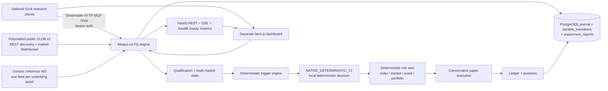
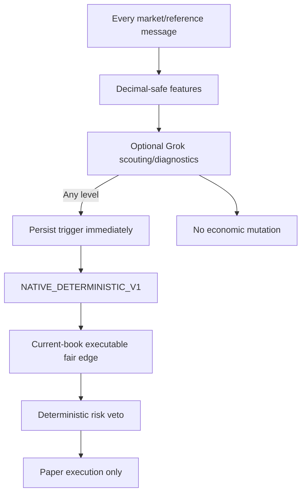
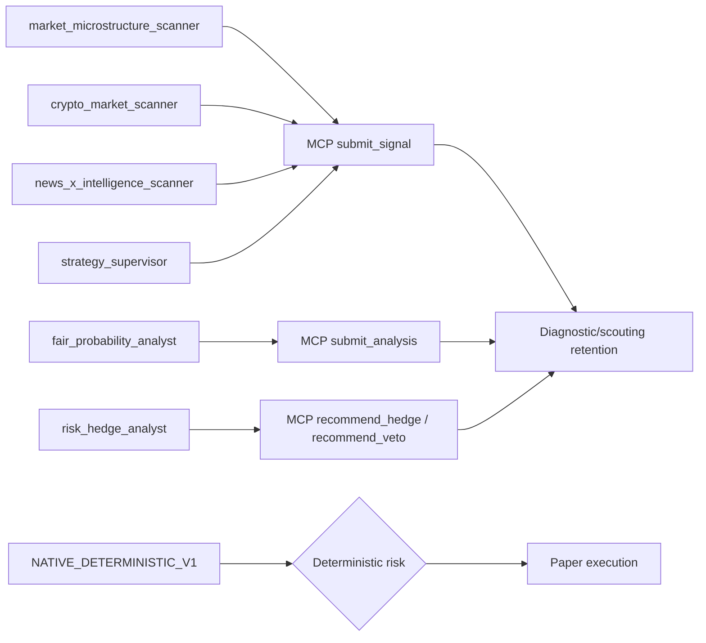
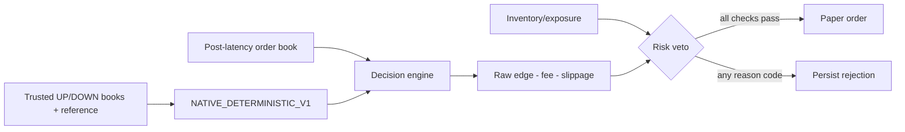

# Polymarket Research & Paper-Trading Engine

Production-shaped, event-driven research system for a continuous engine with an explicit 48-hour experiment/validation window using **public live Polymarket crypto prediction markets** plus **generic external crypto reference prices** for the assets those markets need. It creates **paper orders only**. There is no wallet integration, signer, private CLOB client, or live-order path; `TRADING_MODE` accepts only `paper`, and the live adapter always throws `LIVE_TRADING_DISABLED`.

The engine is **not Bitcoin-only**. It discovers whichever qualifying crypto prediction markets Polymarket currently offers, qualifies them with explicit reason codes, monitors them concurrently with isolated state, and only then opens reference feeds for those underlying assets. Optional **external Grok Bots** may provide bounded scouting and diagnostic research over a bearer-authenticated Streamable HTTP MCP endpoint. Economic decisions remain owned by local deterministic `NATIVE_DETERMINISTIC_V1` by default; the opt-in `ASTRA_BRAIN_V1` paper architecture uses the official OpenAI Responses client with an environment-only key. The repository does not place live Polymarket orders.

Thousands of ticks are cheaply filtered by the deterministic trigger engine. Only a few triggers reach the native decision path. Missing or conflicting Grok research never changes the economic decision or invents paper orders.

## Architecture



The pnpm workspace contains `apps/engine`, `apps/dashboard`, and focused `packages/core`, `packages/db`, and `packages/market-data`. PostgreSQL journal events are the canonical audit trail for durable experiment, trading, and recovery facts. Live `MARKET_SNAPSHOT` and `REFERENCE_TICK` observations are processed in memory and are deliberately not permanent journal records; the report-input admission path stores ordinary canonical research events only while an experiment window is open, with lifecycle boundary events retained separately.

Every important event carries a `traceId`. Journal/dashboard records also carry `marketId` and `asset` when known. `/api/traces/:traceId` reconstructs the source market evidence, native decision, optional Grok research, risk result, order/fill, and resulting position from the append-only journal. Secrets are never written to that trail.

## Discovery and qualification

On a timer (`DISCOVERY_INTERVAL_MS`, default 5 minutes) the engine lists open Polymarket crypto-tagged events through the official client `listEvents` (or optional `POLYMARKET_MARKET_SLUGS`) and runs `qualifyMarket`. Listing is **not** an unbounded crypto catalog scrape: it requests `order=endDate`, `ascending=true`, and `endDateMin`/`endDateMax` matching the qualification remaining-duration window so current and next short-duration Up/Down windows are actually returned. There is **no BTC/ETH/SOL/XRP/DOGE allow-list**. Crypto classification uses category tags and `{ticker}-updown` slug patterns. Per market the engine records `marketId`, slug, title, underlying asset if identifiable, outcome token IDs, binary outcomes, expiry, fee metadata, liquidity, and spread.

Window expiry comes from the official client `market.state.endDate` (Gamma `endDate` datetime). `endDateIso` is a calendar date only and is never used as the tradable window. If that datetime is missing, a `{ticker}-updown-{tf}-{unix}` slug is used only when the unix suffix is aligned to the documented window length (the live 5m/15m series format). The engine does not invent UP/DOWN labels.

`pnpm --filter @pm/engine exec tsx src/cli.ts live-discovery-diag` prints the closest 20 directional crypto markets by expiry with slug, asset, parsed endDate, remaining duration, book/fee flags, binary semantics, and qualification reason codes.

Zero qualified markets at startup is valid. The engine stays up, keeps the database/health/dashboard available, and keeps scanning. Dynamically discovered markets **cannot qualify without a deterministic underlying asset**. The engine does not guess tickers. Manual `POLYMARKET_TOKEN_IDS` fixtures remain separately supported. Asset exposure is aggregated only among markets that share a known asset; unknown identity never silently falls back to per-market exposure.

When a market later qualifies, discovery reconciliation adds it. **Entry-qualified markets** (spread/liquidity/duration pass) can receive new first-leg paper entries. **Managed markets** stay subscribed whenever an open paper position, resting maker, pending hedge, or unsettled position exists — even if they temporarily fail qualification. `MAX_QUALIFIED_MARKETS` never evicts an already-managed position. A flat, disqualified market with no resting order is dropped normally. Reference feeds stay up for any asset still required by a managed market.

Paper settlement uses **public** Polymarket resolution only (`state.closed` / `resolution.umaResolutionStatus` in `{resolved,settled}` and binary 0/1 outcome prices). The engine never guesses a winner. After expiry it polls with bounded backoff, pays winning tokens $1 and losing tokens $0, updates cash/realized PnL, and journals `MARKET_RESOLUTION_OBSERVED` / `POSITION_SETTLED` / `POSITION_WIN|LOSS|BREAKEVEN`. 48h reports include settlement PnL; they are not SELL-fill-only.

HTTP 451/403 from the reference venue is `REGION_BLOCKED` / `PROVIDER_BLOCKED`: fail closed, visible health, no paper execution that requires that reference, and a slow recheck (~30 min) rather than a 30–60s retry storm.

The engine is continuous and can keep monitoring/discovery/feeds alive while `IDLE`; the 48h **experiment/validation window clock does not start on boot**. An operator starts that window with `pnpm experiment:start` or `POST /api/operator/experiment/start` (`ENGINE_OPERATOR_TOKEN` only; the read token cannot start it). The native experiment preflight requires paper mode, Postgres, working discovery, a genuine entry-qualified market, and a fresh required reference; it does not require Grok tokens, xAI, Slack, or external inference.

`EXPERIMENT_CLOSE_POLICY=observe_until_settlement` (default) stops new first legs at 48h, continues hedges/settlement, and writes the FINAL report only after experiment positions settle. `mark_to_market` snapshots remaining books, marks unresolved, and does not fabricate wins/losses.

Engine `/api/dashboard`, `/api/history/*`, `/api/traces/*`, and `/events` require `ENGINE_READ_TOKEN` in production. The dashboard proxy sends that token server-side; it is never `NEXT_PUBLIC_*`. `/health` stays liveness. `/metrics` may use optional `METRICS_TOKEN` for a Fly-private scrape.

Explicit reason codes (reject unless `QUALIFIED`):

| Code | Meaning |
|---|---|
| `NOT_CRYPTO` | Not a crypto prediction market |
| `MARKET_CLOSED` / `MARKET_INACTIVE` | Closed, inactive, or not accepting orders |
| `UNSUPPORTED_STRUCTURE` | Cannot parse a binary token mapping |
| `UNSUPPORTED_BINARY_SEMANTICS` | Cannot safely map outcomes to UP/DOWN; skipped, not invented |
| `MISSING_TOKEN_IDS` | Outcome token IDs unknown |
| `DURATION_OUT_OF_RANGE` | Remaining time outside the configured window |
| `INSUFFICIENT_LIQUIDITY` / `SPREAD_TOO_WIDE` | Listing liquidity/spread fails thresholds (book depth is a runtime risk/execution check) |
| `UNKNOWN_FEE_SCHEDULE` | Fees enabled but metadata missing; paper fills cannot be modeled |
| `INVALID_PRICE` | Outcome prices outside `[0, 1]` |
| `UNKNOWN_UNDERLYING_ASSET` | Dynamic discovery cannot identify a deterministic underlying asset; the market is rejected rather than guessing |
| `DUPLICATE_MARKET` | Same token pair already qualified |
| `STALE_FEED` | Reserved; live feed freshness is enforced at risk time (`MARKET_FEED_STALE`, `REFERENCE_FEED_STALE`, `BTC_FEED_STALE`) |
| `REFERENCE_UNSUPPORTED` | External reference venue has no tradable spot symbol (definitive); market may still be Polymarket-only monitored |

Binary UP/DOWN is used only when outcome labels are clearly Up/Down (or Higher/Lower), or when the market is an explicit directional up/down listing with Yes/No or unlabeled outcomes (Polymarket crypto updown convention: Yes→UP, No→DOWN). Other binaries are skipped.

State is isolated by `marketId` / `tokenId` / underlying asset: books, snapshots, triggers, Grok research, native decisions, compatibility envelopes, risk, positions, maker orders, hedges, traces, journal, metrics, and reports must not mix across markets.

## Reference feeds

`ReferencePriceFeedAdapter` + `ReferenceFeedRegistry` share **one WebSocket per underlying asset**. Mapping is algorithmic (`BTC` → `BTCUSDT` is an example of `{ASSET}USDT`, not a closed list). “All crypto markets” means Polymarket crypto prediction markets first; reference feeds open **only** for assets those qualifying markets need.

Reference symbol probes distinguish `SUPPORTED`, `UNSUPPORTED_DEFINITIVE`, and `TRANSIENT_FAILURE`. Timeouts, network errors, and HTTP 5xx/429 are transient: they are not permanently cached, they fail closed (`referenceRequired` stays true so paper execution cannot proceed without a live reference), and an independent bounded retry timer recovers the feed without waiting for the discovery interval or a process restart. Only a definitive unsupported listing (invalid/unlisted symbol) is cached as Polymarket-only (`referenceRequired=false`).

`/ready` means the engine process is alive, not draining, and PostgreSQL is up. It does **not** require a qualifying market or a Polymarket WebSocket message. Zero currently qualifying markets is a scanner idle state (`discoveryStatus=ZERO_QUALIFIED`), not a crash: discovery continues on `DISCOVERY_INTERVAL_MS`, no market WS is opened until tokens exist, and no paper trade is fabricated. `/health` remains process-liveness. A failed reference feed does **not** keep the whole engine unready.

## Trigger and decision flow



Triggers identify `triggerId`, `traceId`, `marketId`, underlying asset, source, kind, severity, created/expiry, and evidence IDs. They are isolated by market/asset. Deterministic trigger math is unchanged except for per-asset reference windows. BTC rapid-move math still emits `BTC_RAPID_MOVE` for BTC; other assets emit `CRYPTO_REFERENCE_RAPID_MOVE`.

Native evaluation is **fail closed**: monitoring continues, the trigger remains available in live engine state, active experiment triggers are persisted, and missing/stale/malformed market or reference evidence yields no decision and no paper order. Grok submissions, when enabled, are retained only as bounded research/diagnostic evidence and cannot mutate fair probability, risk, orders, fills, positions, or accounting.

### Official Grok activation (re-verified 2026-09-01)

Grok Bot is **not** grok.com Chat, **not** the xAI inference API, and **not** Grok Build hooks. MCP cannot wake a Bot. `get_recent_triggers` is pull, not event-driven. There is **no custom inbound Grok webhook**.

Documented event triggers are Cursor-account integrations, examples Slack message or GitHub notification:

- https://docs.x.ai/grok-bot/skills-routines-and-automations
- https://docs.x.ai/grok-bot/troubleshooting
- Bot-to-Bot messages can wake a Bot, but MCP cannot send them: https://docs.x.ai/grok-bot/chat-and-collaboration

This engine implements `GrokActivationBridge` with `NoopGrokActivationBridge` (default) and `SlackGrokActivationBridge`. Slack is **wake-signal transport only** (minimal payload: `eventType, triggerId, traceId, marketId, asset, severity, triggerKind, createdAt, expiresAt, targetRoles`). Canonical research stays on MCP. Core trigger/consensus/risk code does not import Slack. A future official Grok webhook can replace the provider without rewriting the trigger engine.

Bot-to-Bot fan-out is **not** used. Role-specific activation is preferred. Official docs do **not** prove that a programmatic Slack bot post (versus a human message) fires a Cursor-account routine. Adapter HTTP success is **not** an observed Grok wake. `firstMcpRequestAt` is a **per-trigger** proxy and is assigned only when an MCP request carries that `triggerId` (for example `get_recent_triggers` with `triggerId`, or a write tool / structured submission). A generic `get_recent_triggers` poll is recorded as unattributed MCP activity and does **not** mark every pending trigger as woken.

See [docs/GROK_BOT.md](docs/GROK_BOT.md) for operator steps.



Exactly six logical Grok Bot roles exist. They are **external** MCP clients. They may only read bounded state and submit structured research. They have no wallet, signer, or `place_order` tool. Identity binding is unchanged from PR #1: `authenticated clientId === submission.agentId === submission.role`, plus the role-to-write-tool allow-list (scanners + supervisor: `submit_signal`; fair probability: `submit_analysis`; risk/hedge: `recommend_hedge` / `recommend_veto`).

Role routing (do not wake all six):

| Trigger family | Roles |
|---|---|
| Microstructure / order book | `market_microstructure_scanner`, `crypto_market_scanner`, `fair_probability_analyst` |
| Crypto reference / momentum | `crypto_market_scanner`, `fair_probability_analyst` |
| News / information | `news_x_intelligence_scanner`, `fair_probability_analyst` |
| Hedge / exposure / risk | `risk_hedge_analyst` |
| Severe disagreement / regime / escalation (incl. severity ≥ 3) | `strategy_supervisor` |

## Deterministic trade and risk



Risk has absolute veto authority and emits machine-readable codes. Limits include order/market/total/directional/unhedged exposure, unhedged duration, loss/drawdown, liquidity, edge, spread, signal confidence/expiry, feed staleness, external signal rate, cooldown, duplicates, unknown fees, execution failures, experiment closure, and shutdown.

The Temporal Pair/Hedge strategy is behind a pluggable interface. A pair becomes locked only after both real-book-derived simulated fills exist. Until then, first-leg quantity and directional exposure remain explicit.

## Paper fill model

- **Taker:** wait configured latency, use the latest resulting snapshot, walk visible contra depth, require full quantity, calculate VWAP, actual market fee schedule, and requested-vs-fill slippage. Stale/missing/insufficient depth does not fill.
- **Maker:** create a resting order with visible quantity at the price as `queueAhead`. Never fill on submission. On a later, increasing-sequence book event, consume queue ahead first; only 50% of additional observed disappearance is eligible for fill. Confidence is `0.5`. Cancellations and hidden liquidity cannot be distinguished, so this intentionally understates fills.
- Fee formula follows the market fee schedule: `shares × rate × [p × (1-p)]^exponent`, rounded to five decimals; taker-only schedules charge makers zero. An unknown schedule vetoes.

These are research approximations, not exchange execution guarantees.

## Local setup

Requirements: Node 22+, pnpm 11+, PostgreSQL 17 (or compatible).

```bash
cp .env.example .env
docker compose up -d postgres
pnpm install
pnpm typecheck
pnpm test
pnpm build
```

Run the services in separate terminals:

```bash
pnpm dev:engine
pnpm dev:dashboard
```

Dashboard: `http://localhost:3000`; engine liveness/readiness/metrics: `http://localhost:8080/health`, `/ready`, `/metrics`. Grok MCP: `http://localhost:8080/mcp` (POST, bearer auth). The dashboard connects through its server-side `ENGINE_INTERNAL_URL` proxy, so the private engine address and `GROK_MCP_BEARER_TOKENS` are not shipped to the browser.

### Environment variables

| Variable | Purpose / default |
|---|---|
| `TRADING_MODE` | Zod literal `paper`; anything else fails startup |
| `DATABASE_URL` | Required with `JOURNAL_MODE=postgres` |
| `JOURNAL_MODE` | `postgres`; `memory` is development/test-only and forbidden in production |
| `PAPER_START_BALANCE` | Configurable paper cash, default `1000` |
| `PAPER_EXECUTION_STYLE` | `TAKER` or `MAKER` |
| `PAPER_EXECUTION_LATENCY_MS` | Simulated decision-to-book latency, default `150` |
| `EXPERIMENT_DURATION_HOURS` | Default `48` |
| `EXPERIMENT_CLOSE_POLICY` | `observe_until_settlement` or `mark_to_market` |
| `POLYMARKET_MARKET_SLUGS` | Optional comma-separated explicit live markets; otherwise Gamma listing is discovered |
| `POLYMARKET_TOKEN_IDS` | Optional manual public token IDs (skips discovery timer); missing fee metadata will veto fills |
| `REFERENCE_WS_BASE_URL` | Public reference WS base, default `wss://data-stream.binance.vision/ws` (`stream.binance.com` returns HTTP 451 from some regions) |
| `REFERENCE_REST_BASE_URL` | Used to probe whether `{ASSET}USDT` exists before opening a WS, default `https://api.binance.com` |
| `BTC_WS_URL`, `BTC_SYMBOL` | Deprecated BTC-only leftovers; accepted so old env files parse, ignored by the multi-asset registry |
| `DISCOVERY_INTERVAL_MS` | Re-run crypto market discovery, default `300000` |
| `MAX_QUALIFIED_MARKETS` | Cap on concurrently monitored qualifying markets, default `40` |
| `GROK_MCP_BEARER_TOKENS` | Engine-only `roleId:token` list. `clientId` must be a Grok role ID and is bound to writes (`clientId === agentId === role`). Dashboard never receives it. Token fingerprints, not raw tokens, are audited. |
| `GROK_MCP_ALLOWED_ORIGINS` | Allowed `Origin` values; missing Origin is allowed for server-side Grok clients. Default `https://grok.com,https://x.ai` |
| `GROK_MCP_RATE_LIMIT_PER_MINUTE` | Per-client MCP request cap, default `60` |
| `GROK_ACTIVATION_PROVIDER` | `noop` (default), `slack`, or explicit `xai`. Slack is wake-signal transport only; xAI calls the bounded structured role runtime. A key alone never enables xAI. |
| `SLACK_BOT_TOKEN`, `SLACK_CHANNEL_ID` | Engine-only Slack secrets when provider=`slack`. Never put these on the dashboard, in MCP, journal, logs, or traces. |
| `XAI_API_KEY`, `XAI_API_BASE_URL`, `XAI_MODEL` | Engine-only xAI configuration when provider=`xai`; `XAI_MODEL` is explicit and the key is never persisted or logged. |
| `XAI_SCOUT_CACHE_MAX_ENTRIES`, `XAI_SCOUT_MICRO_TTL_MS`, `XAI_SCOUT_CRYPTO_TTL_MS`, `XAI_SCOUT_NEWS_TTL_MS` | Bounded process-local hot scout research cache and role-specific freshness horizons; no historical persistence. |
| `XAI_REQUEST_TIMEOUT_MS`, `XAI_MAX_OUTPUT_TOKENS` | Per-call timeout and output bounds for the opt-in xAI runtime. |
| `XAI_ALLOW_PORTFOLIO_CONTEXT` | `false` by default. Set `true` only when paper cash/equity/reserved cash and the selected market's bounded position/exposure are explicitly approved for the risk role; no wallet or signer data is ever included. |
| `SLACK_API_URL` | Slack `chat.postMessage` URL, default `https://slack.com/api/chat.postMessage` |
| `ESTIMATED_INFRA_COST_PER_HOUR_USD` | Accrued into economic PnL |
| `DASHBOARD_ORIGIN` | Allowed browser origin for engine API |
| `ENGINE_INTERNAL_URL` | Dashboard server-to-engine URL; not `NEXT_PUBLIC_*` |
| `ENGINE_REGION` | Runtime metadata; `fra` default |
| `GIT_SHA` | Recorded in experiment manifest |
| `REPORT_DIRECTORY` | Optional ephemeral 48h JSON/Markdown export; canonical final report is `experiment_reports` in Postgres |
| `RETENTION_*` | Bounded journal/checkpoint/idempotency TTLs and optional verified-snapshot compaction. See [docs/RETENTION.md](docs/RETENTION.md). `RETENTION_ENABLED`, `RETENTION_COMPACTION_ENABLED`, and `RETENTION_ANALYTICS_ROLLUP_ENABLED` default **false** until operator review. Defaults: telemetry 6h, monitor 24h, completed grace 7d, max 20 batches / 4000 rows per cycle. Active RUNNING/ENTRY_CLOSED canonical input rolls into a verified monotonic accumulator; cleanup is fenced by the stable read's recorded-at/commit coverage. Durable transitions compact only behind two verified recovery snapshots; indexed minimal replay identities remain lifecycle-pinned or bounded by TTL. |

Do not put wallet keys, signing keys, OpenAI keys, or Polymarket private credentials in this milestone. This repository does not create or provision xAI credentials and does not call an xAI inference API.

See [docs/GROK_BOT.md](docs/GROK_BOT.md) for the exact Grok Bot UI steps.

## Deployment

Operator runbook: [docs/DEPLOYMENT.md](docs/DEPLOYMENT.md) (Supabase `DATABASE_URL`, Fly secret **names**, Vercel server-only env, MONITOR_ONLY first boot). This repository does not auto-start the 48h experiment or enable live trading.

## Commands and verification

```bash
pnpm typecheck             # strict TypeScript across all workspaces
pnpm test                  # unit, integration-boundary, MCP/auth, malicious-output acceptance
pnpm build                 # engine bundle + standalone Next dashboard
pnpm smoke                 # deterministic fixture: consensus -> fill -> ledger
pnpm smoke:live            # public Polymarket crypto discovery + reference feeds; no orders/agents
pnpm --filter @pm/engine smoke:discovery  # closest 20 directional crypto markets by expiry
pnpm report                # stream a bounded summary; persist canonical row in Postgres; optional reports/ export
pnpm bench:retention       # report/retention boundedness diagnostic (not a capacity claim)
```

Tests cover pair/PnL math, fee curve, slippage/VWAP, exposure/accounting, native decision math, stale/expired/risk vetoes, bounded Astra paid-dispatch classification/governor behavior, maker/taker execution, insufficient depth, trigger dedupe, Grok non-authority continuity, malformed/duplicate/stale/unauthorized MCP behavior, forbidden trade-tool rejection, journal outage/recovery, reconnect backoff, feed parsing, exact-six topology, the hard live-order gate, multi-market isolation, Grok activation bridge/dedupe/rate limits, and identity-binding regressions.

## 48-hour procedure

1. Set a durable `DATABASE_URL`, `TRADING_MODE=paper`, optional market slugs (otherwise crypto discovery runs), `GROK_MCP_BEARER_TOKENS`, `GROK_ACTIVATION_PROVIDER` (`noop` unless Slack wake transport is configured), `ENGINE_READ_TOKEN`, `GIT_SHA`.
2. Run all verification commands and `pnpm smoke:live`.
3. Boot the engine (`pnpm dev:engine` / Fly). Discovery and feeds may run while the experiment stays `IDLE`.
4. Start the 48h clock explicitly: `EXPERIMENT_DURATION_HOURS=48 pnpm experiment:start` (PowerShell: `$env:EXPERIMENT_DURATION_HOURS='48'; pnpm experiment:start`) or `POST /api/operator/experiment/start` with the operator token. Preflight must pass; a noop activation provider does not count as a validated Grok wake.
5. Point the six Grok Bots at `https://<engine>/mcp` using the operator-managed bearer tokens. Monitor `/ready`, `/metrics`, dashboard SSE state, risk vetoes, Grok signal freshness, directional positions, and journal growth.
6. At 48h the engine enters `ENTRY_CLOSED` and stops new first-leg entries. With `observe_until_settlement` it continues hedges and public settlement until positions are flat, then `COMPLETED` plus the FINAL report. With `mark_to_market` it snapshots remaining books, records unresolved count, and does not invent wins/losses.
7. Rebuild the report at any time with `DATABASE_URL=... EXPERIMENT_ID=... pnpm report`.

The report includes opportunities, accepts/rejects, orders/fills and rates, maker/taker split, completed/incomplete pairs, win/loss events, PnL/cost layers, drawdown/exposure, hedge duration/failures, pair/edge statistics, per-role Grok signal counts, regime/hour attribution, counterfactual event counts, and errors. Trading attribution (`pnlByMarket` / `pnlByAsset`, fills, fees, slippage, opportunities, vetoes) is computed from fills and risk events. `eventCountByMarket` / `eventCountByAsset` are activity volume, not profitability — a noisy market is not treated as more profitable because it generated more journal events. Metrics without observed attribution events remain empty/zero rather than fabricated.

## Fly.io: two independent apps

The engine is a singleton, always-on Machine; the dashboard is independently restartable/autostoppable. The dashboard should use the engine's private Flycast address, e.g. `http://polymarket-engine.flycast:8080`. For this initial milestone use one engine Machine (`--ha=false`) to prevent duplicate paper decisions. Multi-Machine deployment requires leader election/idempotent work claiming.

Validate before deploying:

```bash
fly config validate --strict -a polymarket-engine -c fly.engine.toml
fly config validate --strict -a polymarket-dashboard -c fly.dashboard.toml
docker build -f Dockerfile.engine -t polymarket-engine:local .
docker build -f Dockerfile.dashboard -t polymarket-dashboard:local .
```

Exact creation/deployment sequence (run only after validation; this repository does not deploy):

```bash
fly apps create polymarket-engine --org <org>
fly apps create polymarket-dashboard --org <org>
fly secrets set -a polymarket-engine DATABASE_URL='<postgres-url>' GROK_MCP_BEARER_TOKENS='market_microstructure_scanner:<token>,crypto_market_scanner:<token>,news_x_intelligence_scanner:<token>,fair_probability_analyst:<token>,risk_hedge_analyst:<token>,strategy_supervisor:<token>'
fly secrets set -a polymarket-dashboard ENGINE_INTERNAL_URL='http://polymarket-engine.flycast:8080'
fly deploy -a polymarket-engine -c fly.engine.toml --flycast --ha=false
fly deploy -a polymarket-dashboard -c fly.dashboard.toml --ha=false
```

`fly.engine.toml` has `auto_stop_machines="off"`, one minimum Machine, SIGTERM/60s, `/health`, `/ready`, Prometheus metrics, and restart-always. `fly.dashboard.toml` has its own image/fate, health check, autostop, and no engine credentials. `/mcp` is served by the same engine HTTP service.

## Recovery and operational behavior

On SIGTERM the engine marks itself draining/not-ready, rejects new decisions, stops feed loops, accrues infrastructure cost, saves an experiment/ledger/position/resting-order/Grok-signal checkpoint, closes SSE/journal, and exits before Fly's kill timeout. On boot it migrates/checks PostgreSQL with bounded retry, restores the latest checkpoint, starts discovery (or manual tokens), reconnects Polymarket when tokens exist plus per-asset reference feeds those markets need, and becomes ready when the DB is up and the process is not draining.

Health semantics: `/health` means the process is alive; `/ready` means engine alive (non-draining + database up). Readiness, discovery, and market monitoring are distinct: Fly `/ready` stays 200 with zero currently qualifying markets so a 24/7 scanner is not killed. `discoveryStatus` is `ZERO_QUALIFIED` | `RECONCILING` | `MONITORING`. `marketMonitoring` is true only while qualified tokens are subscribed and the Polymarket stream is connected. Reference-feed failure is degraded for that asset and does not block readiness. Fly health-check failures alone do not restart a process; the always restart policy covers process exits.

## Known limitations

- No live trading, wallet, authentication/signing, settlement transaction, or private CLOB endpoint exists by design.
- A real 48-hour outcome cannot be produced during repository construction. Reports are generated only from recorded events; no performance claim is included.
- Grok Bots are configured in the Grok UI by the operator. This repo never provisions xAI credentials or calls an xAI inference API. There is no custom inbound Grok webhook. Slack activation is adapter HTTP only unless a Bot wake is independently observed.
- If Grok Bots are disconnected, the engine continues deterministic monitoring and will not invent agent activity or paper trades from missing research. `aiCost` remains `$0`.
- Consensus is trigger-scoped: a BTC signal cannot assemble into an ETH trigger.
- Risk is evaluated per order, per market, per underlying asset, and for the total paper portfolio. Polymarket-only markets (unsupported reference) do not require a reference feed.
- Full PostgreSQL/docker recovery and strict Fly validation require locally available PostgreSQL, Docker, and Fly CLI. In-memory recovery tests validate the repository contract but are not a substitute for a fault-injected production database test.
- Public feed payloads/rate limits/fees can evolve. The adapter uses current unified `@polymarket/client` market APIs and preserves raw payloads, but should be revalidated before each experiment.
- Maker queue inference cannot identify cancellations, hidden liquidity, or queue priority; the 50% post-queue rule is deliberately conservative.
- Initial Fly topology is a singleton engine. Horizontal engine scaling is unsafe until leader election and event claiming are implemented.
- Attribution-by-agent/regime/hour and rejected-winner labels require downstream outcome/settlement observations; absent labels are reported as absent, never inferred.

Current implementation references: [MCP Streamable HTTP](https://modelcontextprotocol.io/specification/2026-07-28/basic/transports/streamable-http), [xAI remote MCP tools](https://docs.x.ai/developers/tools/remote-mcp), [Grok connectors](https://docs.x.ai/grok/connectors), [Polymarket developer documentation](https://docs.polymarket.com/), and [Fly Machines documentation](https://fly.io/docs/machines/).
